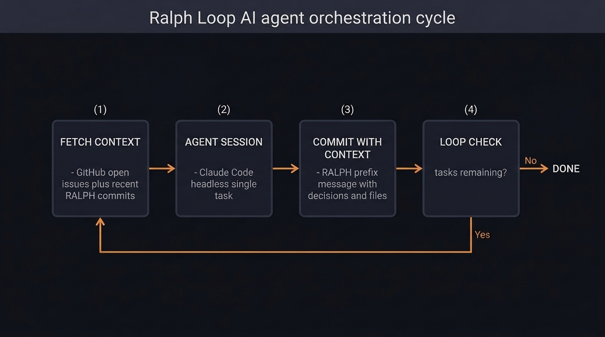

Large features don't fit in a single agent session. Context windows have limits, and as a session drags on, coherence degrades — the agent starts forgetting earlier decisions, contradicting itself, or drifting from the original intent. You end up spending more time correcting course than the agent saved you in the first place.

What you need is a way to break the work into multiple sessions, each focused on a single task, with context preserved between them. That's exactly what a ralph loop does.

## What is a Ralph Loop

The term was coined by [Geoffrey Huntley](https://ghuntley.com/loop/). The idea is straightforward: a loop where each iteration spawns a fresh agent session with a single task to complete. The agent receives two inputs — a list of remaining tasks and an activity log of what's been done so far. It picks the next task, implements it, commits with detailed context, and exits. The loop repeats until there's nothing left to do.



The rest of this post walks through a concrete example of setting up and running a ralph loop to implement a feature from scratch.

## Prerequisites

To follow along you'll need:

- [Claude Code](https://claude.ai/code) — the CLI for Claude
- [gh](https://cli.github.com/) — GitHub's CLI tool, used to manage issues and PRs
- A set of custom Claude Code skills: `grill-me`, `write-a-prd`, `prd-to-issues`, and `qa` — all available from [Matt Pocock's skills repo](https://github.com/mattpocock/skills)

The complete example project is on [GitHub](https://github.com/monkey-codes/ralph-loop-example). Fork the repo and try it yourself — just make sure to enable GitHub Issues on your forked copy, as the loop relies on them.

## Define the Specification

The specification is the most important input to the loop. A vague spec produces vague results — compounded across multiple agent sessions, small misinterpretations snowball into something unrecognizable. I covered this in depth in [Specs Are Grown, Not Written](/specs-are-grown-not-written/) — the short version is that specs need to be iterated on, not written in one shot.

The workflow starts with the `grill-me` skill. It runs an interview, asking detailed questions about the feature and clarifying vague or ambiguous requirements. Think of it as an agile refinement session where the agent plays the role of the team poking holes in your thinking. Once the interview is done, the `write-a-prd` skill takes the context built up in the conversation and produces a detailed PRD as a GitHub issue, complete with user stories.

```
/write-a-prd I want to create a simple python cli TODO application. It should
allow me to create a new todo, modify a todo, delete a todo and mark a todo as
complete. It should only keep todos in memory while the application is running.
Keep it as simple as possible
```

Here's the [example PRD](https://github.com/monkey-codes/ralph-loop-example/issues/1) this produced.

## Break Down into Tasks

The ralph loop takes two inputs each iteration: a list of open GitHub issues and an activity log of recent commits. The issues are one half of that equation — they need to exist before the loop can run.

The `prd-to-issues` skill takes the PRD and generates a list of GitHub issues arranged as a DAG, with dependencies between them. This ensures issues are implemented in a sensible order. In this simple example the dependency graph is linear, but for real-world features you'll often get parallel branches where tasks are independent of each other. This loop implementation processes them sequentially regardless — parallelization is a future improvement.

```
/prd-to-issues https://github.com/monkey-codes/ralph-loop-example/issues/1
```

Before creating the issues, review them. You want to avoid issues that are too large for a single agent session or too small to be worth the overhead. Some merging or splitting is normal — the same judgment you'd apply to sizing user stories in a sprint.

<details>
<summary>Example breakdown from prd-to-issues</summary>

```
Slice 1: Project scaffold
- Type: AFK
- Blocked by: None
- User stories covered: US1 (uv run todo.py works)
- Creates pyproject.toml (uv, Python >=3.11, pytest dev dep), minimal
  todo.py stub that starts and exits, tests/ directory. uv run todo.py
  and uv run pytest both succeed.

---
Slice 2: Add / list / quit — core REPL
- Type: AFK
- Blocked by: Slice 1
- User stories covered: US1, US2, US3, US4, US5, US6, US13, US14
- Implements TodoItem, TodoStore.add() + TodoStore.list(),
  TodoNotFoundError, and the REPL with add, list, quit/exit, and
  startup help text. Tests for add and list.

---
Slice 3: Complete / delete / edit + error handling
- Type: AFK
- Blocked by: Slice 2
- User stories covered: US7, US8, US9, US10, US11, US12
- Implements TodoStore.complete(), update(), delete(), wires done,
  edit, delete commands into the REPL, adds visual distinction for
  completed items, and error messages for unknown IDs and unrecognised
  commands. Tests for all three mutations and TodoNotFoundError.
```

</details>

Here's an [example issue](https://github.com/monkey-codes/ralph-loop-example/issues/3) generated by the skill.

## Run the Loop

The ralph loop itself is a bash script. Each iteration it fetches the open issues and recent commit history, combines them with a prompt, and passes everything to a headless Claude session. The agent works on a single issue, commits the result, closes the issue, and exits. The loop then starts the next iteration with updated context.

Here's the script:

```bash
set -e

if [ -z "$1" ]; then
  echo "Usage: $0 <iterations>"
  exit 1
fi

SCRIPT_DIR="$(cd "$(dirname "${BASH_SOURCE[0]}")" && pwd)"

for ((i=1; i<=$1; i++)); do
  echo "Iteration $i"
  echo "--------------------------------"

  ISSUES=$(gh issue list --state open --json number,title,body,comments --limit 100)
  RALPH_COMMITS=$(git log --grep="RALPH" -n 10 \
    --format="%H %ad %s" --date=short 2>/dev/null || echo "None")

  result=$(echo "## Open GitHub Issues

$ISSUES

## Recent RALPH Commits

$RALPH_COMMITS" | claude -p --dangerously-skip-permissions \
    "$(cat "$SCRIPT_DIR/ralph-prompt.md") \
Read the open GitHub issues from stdin. \
Pick the most important issue, work on it, commit, and close the issue when done. \
ONLY WORK ON A SINGLE ISSUE.")

  echo "$result"
done
```

A word of caution: the script uses `--dangerously-skip-permissions`, which allows the agent to run any tool — including destructive shell commands — without human approval. This is necessary because the loop runs headless with no one to confirm each action. Run it in an isolated environment: a fresh clone, a throwaway branch, or a container. Don't point it at a repo with uncommitted work you care about.

The context passing mechanism is the key design decision. Each commit message is prefixed with `RALPH:` and includes the task completed, a reference to the PRD, key decisions made, and files changed. These commits are then fed back into the next iteration as the activity log. The agent can read what happened in previous sessions and make informed decisions about what to do next — despite having no memory of those sessions.

The prompt that drives each agent session handles task selection, execution, and the commit format:

```markdown
# TASK SELECTION

Pick the next task. Prioritize tasks in this order:

1. Critical bugfixes
2. Tracer bullets for new features
3. Polish and quick wins
4. Refactors

# EXPLORATION

Explore the repo and fill your context window with relevant
information that will allow you to complete the task.

# EXECUTION

Complete the task.

# COMMIT

Make a git commit. The commit message must:

1. Start with `RALPH:` prefix
2. Include task completed + PRD reference
3. Key decisions made
4. Files changed
5. Blockers or notes for next iteration

# THE ISSUE

If the task is complete, close the original GitHub issue.
If the task is not complete, leave a comment on the GitHub
issue with what was done.

# FINAL RULES

ONLY WORK ON A SINGLE TASK.
```

The "tracer bullets" prioritization comes from _The Pragmatic Programmer_ — build a tiny end-to-end slice first, then expand. This encourages the agent to get something working through all layers before filling in details.

To run the loop:

```bash
./ralph.sh 5  # 5 iterations, one per issue
```

Here's an [example commit](https://github.com/monkey-codes/ralph-loop-example/pull/5/commits/009c94212b85c9d9cd1eb433ce4b0f6c3951a97f) generated by the loop.

## Review and QA

Once the loop completes, the work still needs human eyes. I use Claude Code to generate the pull request — pointing it at the recent commits and the PRD to produce a meaningful description. Here's the [example PR](https://github.com/monkey-codes/ralph-loop-example/pull/5).

The more important step is manual QA. Individual slices may pass their own tests while the integrated feature has gaps — this is specification drift in action. Each slice looks correct in isolation, but compounding small decisions across sessions produces something that doesn't quite match the original intent.

The `qa` skill helps here. Test the feature manually, create new GitHub issues for anything that's off, and run the ralph loop again to work through them. The loop is reusable — it doesn't care whether the issues came from a PRD breakdown or a QA session.

## Conclusion

The ralph loop works. For this example, three issues went from PRD to working pull request without manual coding. The detailed commit history and GitHub issues serve double duty — they're the context mechanism that makes the loop function, and they're also a clear audit trail of what was built and why.

It's not perfect. Specification drift is the biggest risk — I've written about this [before](/specs-are-grown-not-written/). Integration failures across slices are common. The best mitigation I've found is ensuring one of the later tasks explicitly runs integration tests across the full feature, catching regressions before the PR is raised.

I've only tested this with around 10 issues in a PRD. I intend to keep experimenting — the approach offers a practical way to have long-running agents work on problems that exceed a single session, and the infrastructure is remarkably simple.

The code can be found on [GitHub](https://github.com/monkey-codes/ralph-loop-example).
