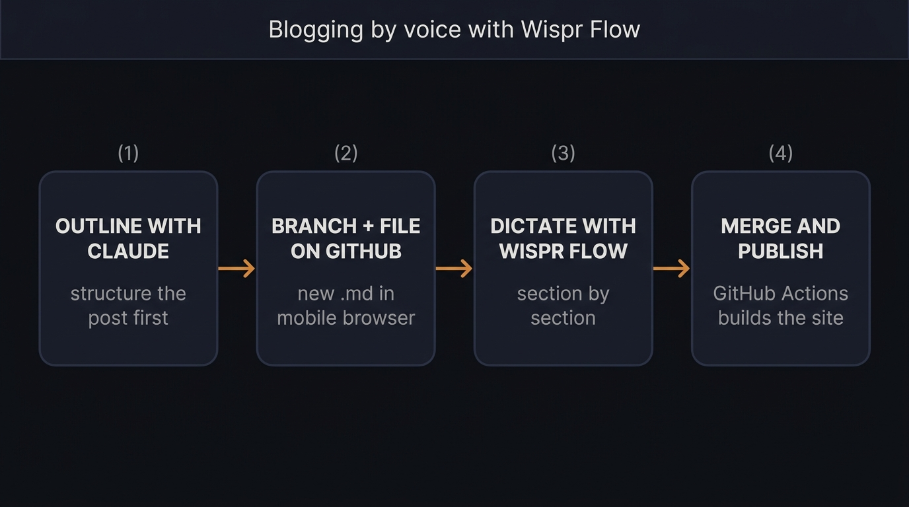

## Why I Tried This

I've been trying to blog on and off for years, and it takes a lot of effort to sit down, collect my thoughts and refine a post. So my posts come out slowly.

My personality makes me want to polish the content a lot more than is necessary for a blog that is really just about capturing what I learn and sharing it. So I decided to try dictating a post with Wispr Flow on my phone. This post captures that experience.

## The Setup

The basic setup is that I use Wispr Flow on my phone for dictation and have it write a Markdown file directly in a branch on my GitHub repo using my browser. Once the branch is merged, GitHub Actions builds and publishes the post to my blog automatically. This part is definitely clunky. Opening the GitHub website in a mobile browser and creating a branch and a new file feels very unnatural. I'll need to find a more natural way to create the content and get it into GitHub.

## The Workflow in Practice

1. I open a new branch in GitHub in the browser and create a new Markdown file in the content folder.
2. I use a Claude session to outline the post, which helps me collect and organise my thoughts and gives the post some structure. I copy the outline into the new Markdown file.
3. I move through each section and dictate, paragraph by paragraph, what I want to say using Wispr Flow.
4. In its most basic form, I'd then merge the branch to publish. I suspect the result would be very rough and would need another pass to smooth the edges.

## What Worked Well

It gets thoughts out of my head and into a file quickly, with far less friction. I tend to overthink what I'm trying to say when typing, so with some practice I think speaking will be a lot easier.

I also think speaking may produce a tone that is more natural and human than my usual posts.

Wispr Flow itself works exceptionally well, given that I have a very strong accent and English is my second language. It handles my accent with very few mistakes. I even tried speaking Afrikaans in a different session and it picked up the words perfectly.

## What Didn't Work

- I tried to set up a Wispr Flow snippet to insert the frontmatter. It didn't work at all — it simply transcribed the words I was saying. I need to look into how snippets work.
- Transcription isn't flawless. It turned "empty file" into "empathy file", so a proofreading pass is still needed.
- GitHub's web editor is basic. It's fine for a quick edit, but on a phone it gets awkward for anything longer.
- There's no quick way to preview. I only see the rendered post once the branch is merged and the build has run.
- Speaking makes me ramble. I'm not used to dictating into my phone yet and it feels awkward, but I think that will improve with practice.

## Tips and Tweaks

- Use AI to outline the post before you start talking. Starting with an empty file and just talking didn't work for me.
- Keep a frontmatter template to paste in, since dictating it doesn't work.
- Dictate first, format second. Don't try to speak Markdown — get the words down, then tidy up the formatting.
- The Wispr Flow free tier was just about enough for one post. You'd need a paid plan to do this seriously.

## Verdict

I'm going to keep using this method for a while before deciding whether it's the way to go. There's something here. I might blog more this way, even if the quality is lower than what I used to write.

Editing in the browser on GitHub isn't the ideal approach, so that's the first thing I'd change. I may also try a workflow where I dictate a rough version like this, then run it through an AI pass to polish and sharpen the language.
